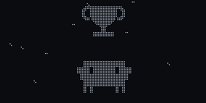
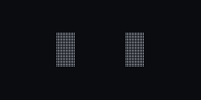
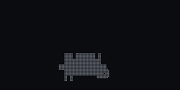

# tiny clawd

<p align="center"></p>

a tiny Clawd that lives on my desk. it watches my Claude Code sessions, shows how much of my
usage limits are left and reacts to what claude is doing. thinking, running tools, waiting for me,
done. sometimes it just plays football.

fan-made project, not affiliated with Anthropic.

## what it reacts to

| claude code | tiny clawd |
|---|---|
| prompt sent | thinking |
| Read, Grep, Glob | reading, searching |
| Edit, Write | typing |
| Bash | terminal |
| web search / fetch | spinning globe |
| subagents | a squad of mini Clawds passing a ball |
| permission or question | surprised, then the screen flashes until you answer |
| test passed | goal, header, bicycle kick |
| test failed | yellow card, then red card |
| commit | party, knee slide, trophy |
| context compacted | squish |
| done | small win for short tasks, goal or trophy for long ones |
| usage running low | tired, stoppage time, limit hit |
| nothing going on | looks around, music, football, naps and dreams |
| touch the head | petted, giggle, usage screen, love |

## animations

71 of them, drawn on the real 128x64 grid. the eyes are Clawd's pixel slits, the mini Clawd
uses the same block art as the Claude Code banner. these gifs come straight from the firmware
running in the desktop sim.

| | | |
|---|---|---|
|  thinking |  reading (Read) |  typing (Edit) |
|  terminal (Bash) |  web search |  needs you |
|  subagents squad |  goal |  bicycle kick |
|  trophy |  party |  usage |
|  context jar |  music |  dance |
|  dream |  petted |  keepy uppy |

the firmware versions are time based C++ in [`firmware/components/pet`](firmware/components/pet).
the first designs were sketched in python: [`animations/`](animations).

there is also a 3D viewer: `hardware/build_live_viewer.py` builds `hardware/out/clawd_live.html`,
the printed body with every animation playing on its screen.

## games

there is only one button, the touch pad on its head. so everything works with tap, double tap
and hold:

- hold the head: a ring fills around the screen. let go early and it's love, hold until it's
  full and the menu opens
- in the menu: tap = next, hold = open, double tap = back
- in a game: press = jump / kick / allow, hold the full ring to leave

| | |
|---|---|
|  bug run: jump over bugs and 429 walls |  keepy uppy: tap when the ball hits the head |
|  penalties: aim, power, then you're in goal |  permission panic: allow `npm test`, never `rm -rf /` |

## hardware

- ESP32-C3 Super Mini
- 1.3" SH1106 128x64 OLED (I2C, SDA 20 / SCL 21)
- TTP223 touch pad on the head (GPIO 1)
- printed body + stand, see [`hardware/`](hardware)

the inside of the body is the [Mochi housing by Dave0616](https://makerworld.com/en/models/1844353-the-mochi-housing-and-inner-frame-dasai-mochi)
(inner frame, OLED holder, back plate). i only redesigned the outside, so the original electronics
frame fits without changes. there is also a small Macintosh style version.

print files are in [`hardware/print/`](hardware/print), each folder has a README with what to print.

## how it works

claude code hooks and the status line feed a small python daemon on the laptop
([`bridge/`](bridge)), which sends short text lines over usb (`ev tool Bash`, `ev perm`,
`usage 5h=42 ...`, see [`firmware/PROTOCOL.md`](firmware/PROTOCOL.md)). the ESP32 runs the pet
engine and decides what to play. no laptop = it just lives on its own.

every tool has its own look: Read reads lines, Grep sweeps for matches, Edit types code, Bash
runs a little terminal, web searches spin a globe, subagents become a squad of mini Clawds
passing a ball. when claude needs you the whole screen flashes. when claude is done it
celebrates, longer tasks get bigger celebrations (goal, trophy, bicycle kick).

when nothing is going on it does its own thing: looks around, peeks, listens to music, plays
football, gets bored, yawns, naps and dreams. at night it falls asleep faster. poke it and it
reacts (tap, double tap for usage, long press for love). animations come from weighted pools
with cooldowns, so it rarely does the same thing twice in a row.

## try it without the board

```bash
cd firmware/sim && make
./sim script scripts/demo.txt          # fake claude session -> out/demo.frames
python3 gif.py out/demo.frames         # -> out/demo.gif (needs pillow)
python3 gif.py --scale 2 out/*.frames  # smaller gifs
./sim anim goal ; ./sim list ; ./sim soak 12
./sim game run                         # a game played by its own bot -> out/game_run.frames
```

## status

- [x] body, stand and print files
- [x] animation designs (71 in the firmware)
- [x] firmware (esp-idf), builds, not tested on the board yet
- [x] laptop bridge (claude code status line + hooks over usb)
- [x] one button menu + 4 games
- [ ] focus timer, clock, quiet mode
- [ ] high scores kept after a reboot

## build the hardware files

```bash
pip install -r hardware/requirements.txt
cd hardware && ./build.sh
```

needs openscad 2025+ and the original Mochi STLs in `hardware/original/` (download from the link above).
