# tiny clawd

a tiny Clawd that lives on my desk. it watches my Claude Code sessions, shows how much of my
usage limits are left and reacts to what claude is doing. thinking, running tools, waiting for me,
done. sometimes it just plays football.

fan-made project, not affiliated with Anthropic.

<p>
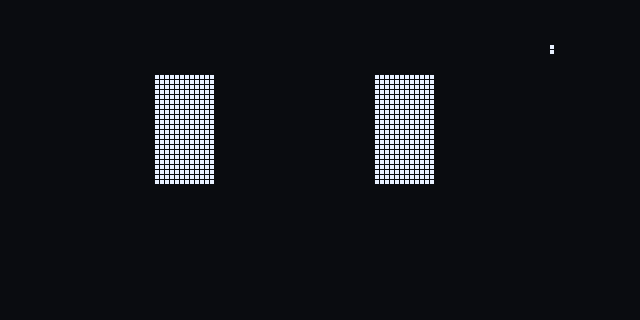
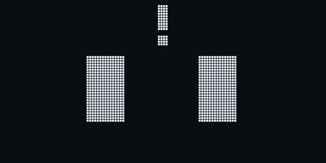
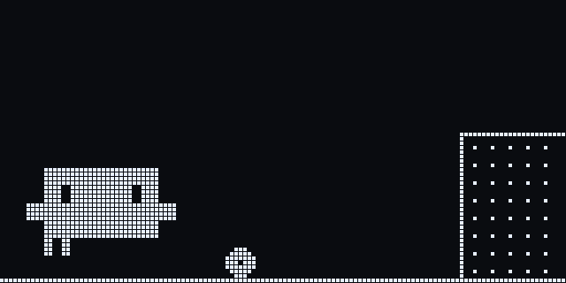
</p>

## hardware

- ESP32-C3 Super Mini
- 1.3" SH1106 128x64 OLED (I2C, SDA 20 / SCL 21)
- TTP223 touch pad on the head (GPIO 1)
- printed body + stand, see [`hardware/`](hardware)

the inside of the body is the [Mochi housing by Dave0616](https://makerworld.com/en/models/1844353-the-mochi-housing-and-inner-frame-dasai-mochi)
(inner frame, OLED holder, back plate). i only redesigned the outside, so the original electronics
frame fits without changes. there is also a small Macintosh style version.

print files are in [`hardware/print/`](hardware/print), each folder has a README with what to print.

## animations

all of them are drawn on the real 128x64 grid. the eyes are Clawd's pixel slits, the mini Clawd
uses the same block art as the Claude Code banner.

| | | |
|---|---|---|
| 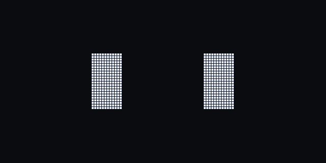 blink |  look around | 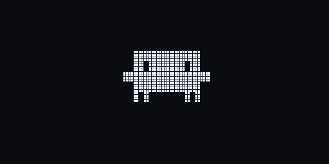 spin |
| 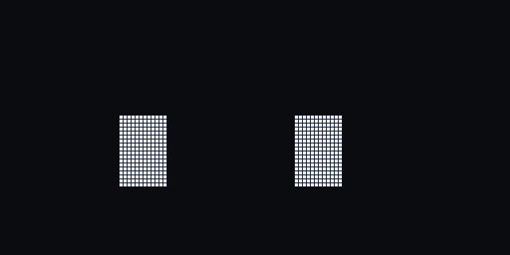 working | 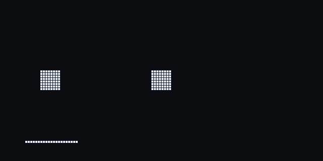 searching |  done |
| 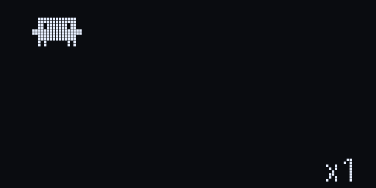 subagents | 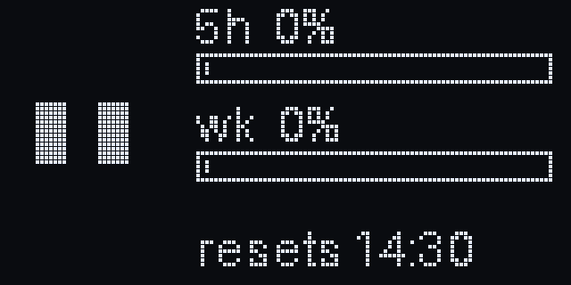 usage | 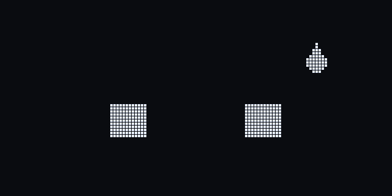 tired |
|  keepy uppy | 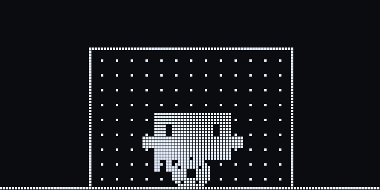 penalty save | 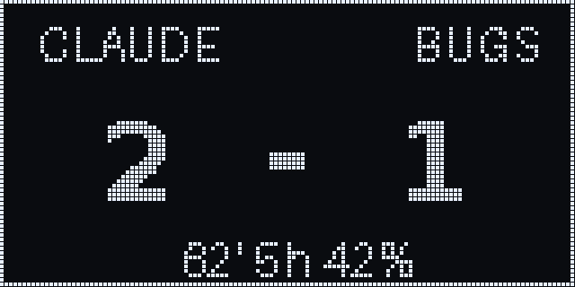 scoreboard |
|  petted |  sleepy | 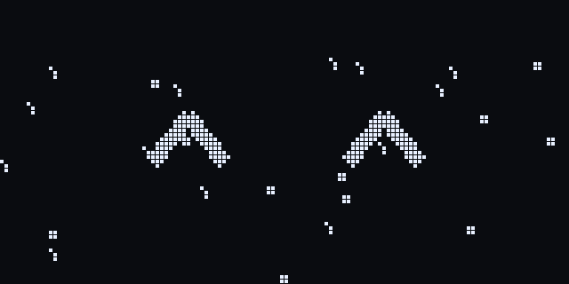 party |

all 46: [`animations/gifs/`](animations/gifs). they are generated by
[`animations/eyes.py`](animations/eyes.py) (`python3 eyes.py`).

## status

- [x] body, stand and print files
- [x] animation designs
- [ ] firmware (esp-idf)
- [ ] laptop bridge (claude code status line + hooks over usb)

## build the hardware files

```bash
pip install -r hardware/requirements.txt
cd hardware && ./build.sh
```

needs openscad 2025+ and the original Mochi STLs in `hardware/original/` (download from the link above).
