# tiny clawd

<p align="center">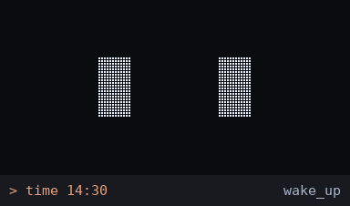</p>

<p align="center">
<b><a href="https://tinyclawd.deepakpopli.in">website</a></b> ·
<b><a href="https://youtu.be/aFLVqkyy6DE">watch the film</a></b> ·
<b><a href="https://github.com/deepakpopli/tinyclawd/releases/latest">download the firmware</a></b> ·
<b><a href="#set-it-up">set it up</a></b>
</p>

a tiny 3D printed Clawd with an OLED face that shows what Claude Code is doing.

it lives on my desk, plugged into the laptop over USB. it thinks when claude thinks, types when
claude edits, calls me back when a session is waiting, shows how much of my usage limits are
left and celebrates when the work is done. when nothing is going on it just plays football.

about $5 of parts, 100+ animations, 7+ games, one touch pad. open source.

fan-made project, not affiliated with Anthropic.

## the film

[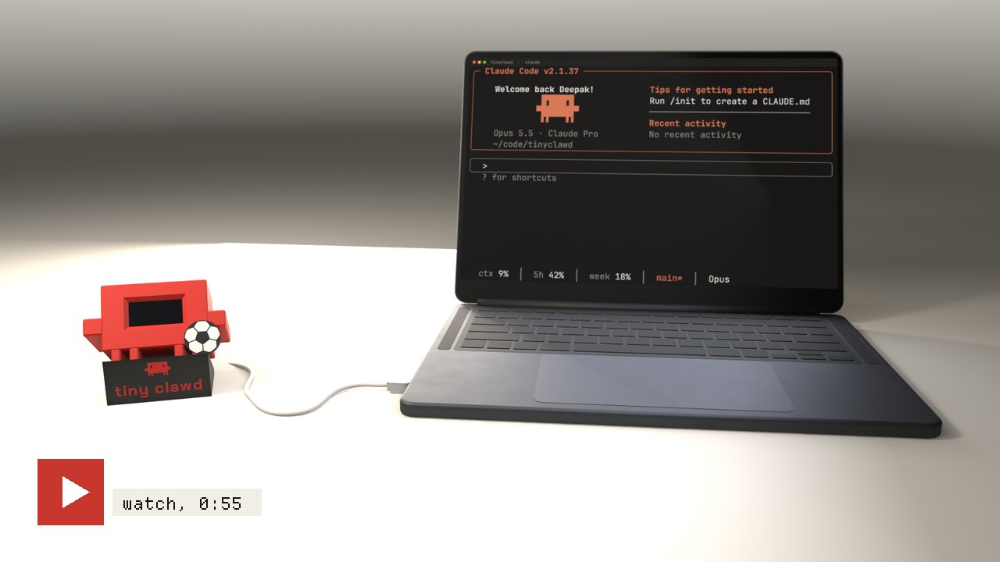](https://youtu.be/aFLVqkyy6DE)

55 seconds, rendered in Blender from the real print files. the screen in it plays the real
firmware, frame by frame.

## what it reacts to

| claude code | tiny clawd |
|---|---|
| prompt sent | thinking |
| Read, Grep, Glob | reading, searching |
| Edit, Write | typing |
| Bash | terminal, a crane for builds, test tubes for tests, packages for installs |
| web search / fetch | spinning globe |
| subagents | a squad of mini Clawds passing a ball |
| permission or question | surprised, then the screen flashes with the project name until you answer |
| tool error | surprised, or explaining the bug to a rubber duck |
| test passed | goal, header, bicycle kick, a squashed bug |
| test failed | yellow card, then red card |
| commit | a branch merging, party, knee slide, trophy |
| context compacted | squish |
| done | small win for short tasks, goal or trophy for long ones |
| usage running low | tired, stoppage time, limit hit |
| music playing (spotify, youtube...) | now playing with the song name, three full screen visualizers, headbanging |
| you typing | it watches the keys go down |
| nothing going on | looks around, coffee, juggling, football, naps and dreams |
| touch the head | tap: petted (sometimes shy or a wink), double tap: usage, hold: love |

## animations

100+ of them, drawn on the real 128x64 grid. the eyes are Clawd's pixel slits, the mini Clawd
uses the same block art as the Claude Code banner. these gifs come straight from the firmware
running in the desktop sim.

| | | |
|---|---|---|
| 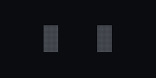 thinking | 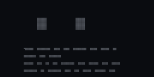 reading (Read) | 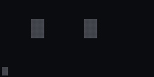 typing (Edit) |
| 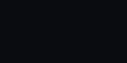 terminal (Bash) | 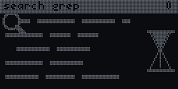 code search (Grep) |  web search |
| 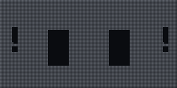 needs you |  subagents squad | 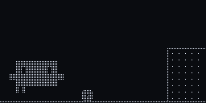 goal |
| 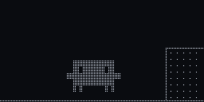 bicycle kick | 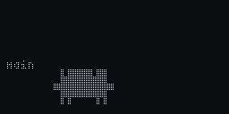 commit | 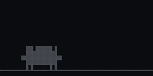 test passed |
| 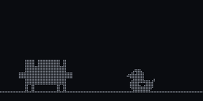 tool error | 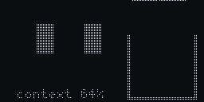 context filling up | 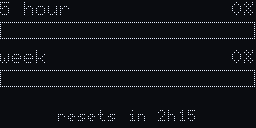 usage |
|  now playing |  music |  dance |
|  coffee | 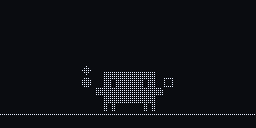 juggling | 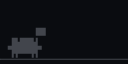 paper plane |
| 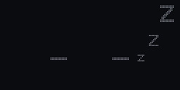 dream | 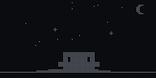 stargazing |  petted |

the firmware versions are time based C++ in [`firmware/components/pet`](firmware/components/pet).
the first designs were sketched in python: [`animations/`](animations).

## games

there is only one button, the touch pad on its head. so everything works with tap, double tap
and hold:

- hold the head: a ring fills around the screen. let go after about a second and it's love,
  keep holding until the ring is full and the menu opens
- in the menu: tap = next, hold = open, double tap = back
- in a game: press = jump / kick / allow, hold the full ring to leave

7+ games. they're meant to be easy, it's a desk toy. best scores stay after unplugging.

| | |
|---|---|
| 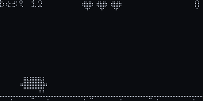 bug run: jump over bugs | 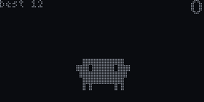 keepy uppy: tap when the ball lands |
| 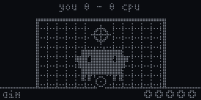 penalties: shoot, then you're in goal | 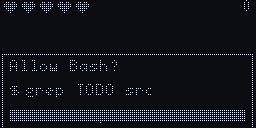 permission panic: allow `npm test`, never `rm -rf /` |
| 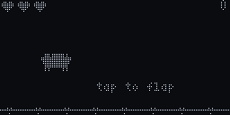 flappy clawd: wide gaps, take it easy | 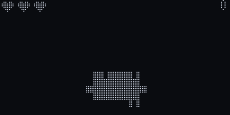 token catch: tap to turn around |
| 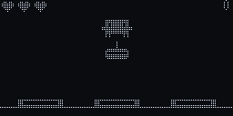 whack a bug: don't bonk your friend | |

## hardware

| part | approx |
|---|---|
| ESP32-C3 Super Mini | ~$2 |
| 1.3" SH1106 128x64 OLED, I2C | ~$2 |
| TTP223 touch pad | ~$0.2 |
| PLA, red + black, ~40 g | ~$1 |
| a USB-C cable that carries data | you have one |
| **total** | **about $5, plus shipping** |

wiring is in [set it up](#set-it-up).

the inside of the body is the [Mochi housing by Dave0616](https://makerworld.com/en/models/1844353-the-mochi-housing-and-inner-frame-dasai-mochi)
(inner frame, OLED holder, back plate). i only redesigned the outside, so the original electronics
frame fits without changes. there is also a small Macintosh style version.

print files are in [`hardware/print/`](hardware/print), each folder has a README with what to
print. no supports needed.

## set it up

you need the printed body, the parts above, a USB-C cable that carries data, and a linux laptop
with claude code (ubuntu, debian, fedora, arch and friends). on mac or windows you can still
flash the board from the browser, the laptop side is linux only for now.

**1. print it.** body, back plate and stand are in [`hardware/print/`](hardware/print), each folder
has a README. no supports.

**2. wire it.**

| from | to the ESP32-C3 |
|---|---|
| OLED SDA | GPIO 20 |
| OLED SCL | GPIO 21 |
| touch pad OUT | GPIO 1 |
| OLED and touch pad VCC | 3V3 |
| OLED and touch pad GND | GND |

**3. plug it in and run one command.**

```bash
curl -fsSL https://tinyclawd.deepakpopli.in/install.sh | bash
```

it flashes the latest firmware (it asks first), sets up the laptop side and hooks it into claude
code. it asks before it uses sudo and backs up your claude code settings and status line script
before it changes them. flashing resets the pet's saved settings and best scores. run it again
to update. restart claude code and say hi.

undo: `python3 ~/.tinyclawd/bridge/setup.py --remove && rm -rf ~/.tinyclawd`

<details>
<summary><b>or let claude code set it up</b></summary>

paste this into claude code, it asks before every change (also in
[`docs/setup-prompt.md`](docs/setup-prompt.md)):

```text
Set up Tiny Clawd (https://github.com/deepakpopli/tinyclawd) on this Linux machine for me.
Before each step, say what you will do and wait for my OK. Never run sudo: show me the command and I run it.
1. Clone the repo to ~/.tinyclawd (git pull if it is already there). Read README.md and bridge/README.md.
2. Check that /usr/bin/python3 (or python3) can import serial. If not, tell me the package for my distro.
3. Ask if I want to flash the board. Only if I say yes: find it by its Espressif USB id, get the .bin from
   the latest GitHub release and flash it at 0x0 with esptool (stop tinyclawd-daemon first if it runs).
   If the port is not writable, tell me how to join the dialout group.
4. Run python3 ~/.tinyclawd/bridge/setup.py --dry-run and show me what it would change. If it says I have
   no status line, ask me which one I want: visible (shows usage), hidden (only feeds Clawd) or none.
   Then run setup.py for real, with --statusline <my answer> if you asked.
5. Test it: python3 ~/.tinyclawd/bridge/tinyclawd.py send ev done should make Clawd celebrate.
6. Tell me to restart Claude Code, and how to undo: python3 ~/.tinyclawd/bridge/setup.py --remove && rm -rf ~/.tinyclawd
```

</details>

<details>
<summary><b>or set it up by hand</b></summary>

1. flash the board (from the browser, below)
2. on the laptop (python 3.8+ and pyserial):

```bash
git clone https://github.com/deepakpopli/tinyclawd
cd tinyclawd
sudo apt install python3-serial            # fedora: python3-pyserial, arch: python-pyserial
python3 bridge/setup.py --dry-run          # shows what it would change, changes nothing
python3 bridge/setup.py                    # background service + claude code hooks + usage
python3 bridge/setup.py --statusline visible   # no status line yet: add one that shows usage
python3 bridge/setup.py --remove           # undo it all
```

restart claude code after. if the port can't be opened: `sudo usermod -aG dialout $USER` (on arch
the group is `uucp`), then log out and in. more in [`bridge/`](bridge).

</details>

<details>
<summary><b>flash from the browser (mac, windows, linux)</b></summary>

1. download `tinyclawd-esp32c3-v1.0.0.bin` from the
   [releases page](https://github.com/deepakpopli/tinyclawd/releases)
2. open [espressif's web flasher](https://espressif.github.io/esptool-js/) in chrome or edge
3. connect, pick the file at address `0x0`, press program

or build it yourself with esp-idf, see [`firmware/`](firmware).

</details>

<details>
<summary><b>what setup changes</b></summary>

- a user service, `tinyclawd-daemon`, that talks to the board (`journalctl --user -u tinyclawd-daemon`)
- hooks in `~/.claude/settings.json`. yours stay as they are, it only touches entries that run
  `tinyclawd.py`
- `/clawd` in claude code shows your usage on the pet, `/clawd context` the context window. it
  never reaches claude, so it costs nothing
- usage comes from claude code's status line. no status line yet: it asks if you want a visible
  one (`ctx 37% · 5h 42% · week 18%` at the bottom of claude code), a hidden one that only feeds
  the pet, or none. `--statusline visible|hidden|none` (or `TINYCLAWD_STATUSLINE` for install.sh)
  answers it ahead of time. a shell script that reads stdin with `input=$(cat)`:
  it adds one line after that. anything else: it prints the line for you to add. the 5 hour and
  weekly limits only show when claude code puts them in the status line data (a claude
  subscription login), context works either way

</details>

<details>
<summary><b>optional extras</b></summary>

without them that feature just stays off:

| package (ubuntu name) | gives you |
|---|---|
| `playerctl` | the song name in music mode |
| `pulseaudio-utils` (`parec`) | the equalizer from what the laptop plays |
| `xinput` | typing reactions (X11 only) |
| `python3-numpy` | a nicer equalizer |

</details>

## how it works

claude code hooks and the status line feed a small python daemon on the laptop
([`bridge/`](bridge)), which sends short text lines over usb (`ev tool Bash`, `ev perm`,
`usage 5h=42 ...`, see [`firmware/PROTOCOL.md`](firmware/PROTOCOL.md)). the ESP32 runs the pet
engine and decides what to play. no laptop = it just lives on its own.

several claude code sessions share one Clawd. whoever needs you wins, then whoever is working.
little dots in the corner show how many sessions are busy.

when nothing is going on it does its own thing. animations come from weighted pools with
cooldowns, so it rarely does the same thing twice in a row. at night it falls asleep faster.

## privacy

nothing leaves the laptop except the short lines that go to the pet over USB. the daemon has no
network code and there are no accounts.

- typing: it counts key presses in every window (X11 only, off on Wayland). the key codes
  come through the `xinput` pipe but are never parsed, kept or sent, only the keys per second
  go to the pet. off with `TINYCLAWD_NO_KEYS=1`
- music: the song name comes from `playerctl`. the equalizer levels are worked out on the laptop
  from what it is playing, the sound itself is never stored or sent. off with `TINYCLAWD_NO_EQ=1`
- claude code: the pet gets the event, the tool name (for Bash only the kind, like build or test),
  the project folder name and your usage percentages. never your prompts or code

## try it without the board

```bash
cd firmware/sim && make
./sim script scripts/demo.txt          # fake claude session -> out/demo.frames
python3 gif.py out/demo.frames         # -> out/demo.gif (needs pillow)
./sim anim goal ; ./sim list ; ./sim games
./sim game run                         # a game played by its own bot -> out/game_run.frames
```

## build the hardware files

```bash
pip install -r hardware/requirements.txt
cd hardware && ./build.sh
```

needs openscad 2025+ and the original Mochi STLs in `hardware/original/` (download them from the
link above, they are not in this repo).

## license and credits

- code: [MIT](LICENSE)
- print files: [CC BY-NC-SA 4.0](hardware/LICENSE), because the inner frame is Dave0616's
  [Mochi housing](https://makerworld.com/en/models/1844353-the-mochi-housing-and-inner-frame-dasai-mochi)
  (same license). so please don't sell printed ones
- site: [three.js](https://threejs.org) (MIT), fonts [Archivo](https://github.com/Omnibus-Type/Archivo)
  and [Departure Mono](https://departuremono.com) (SIL OFL), stand lettering in Chakra Petch (SIL OFL).
  licence files sit next to them

fan-made, not affiliated with Anthropic. Clawd and Claude Code belong to them.

## made by

Deepak Popli: [deepakpopli.in](https://deepakpopli.in) · [X @DeepakPopli02](https://x.com/DeepakPopli02) ·
[LinkedIn](https://www.linkedin.com/in/deepakpopli/). built one? show me on X.
